# Wazuh SIEM Detection Lab

A home SOC lab built on VMware to practice detection engineering end to end:
deploy a SIEM, onboard an endpoint, simulate real attacks from a dedicated
attacker VM, and confirm each one is detected, from a single failed login all
the way to writing custom rules at both the host and network layers.

The lab is built around one question, asked for each attack: **did my logging
catch it, did a rule fire, and if not, what rule should exist?**

## Lab environment

Three VMs on an isolated VMware NAT network (VMnet8, `192.168.255.0/24`).

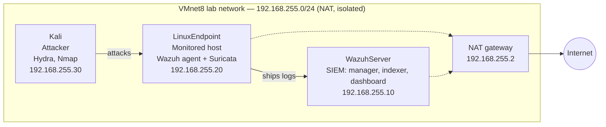

| Host | Role | OS | IP |
|------|------|-----|-----|
| WazuhServer | SIEM: manager, indexer, dashboard (all-in-one) | Ubuntu Server 24.04 | 192.168.255.10 |
| LinuxEndpoint | Monitored endpoint + Suricata NIDS | Ubuntu Server 24.04 | 192.168.255.20 |
| Kali | Attacker (used only against my own lab VMs) | Kali Linux 2026.2 | 192.168.255.30 |

**Tools:** Wazuh 4.14.8, Suricata 7.0.3, Hydra, Nmap, VMware Workstation.

> All attacks in this lab were run against my own VMs on an isolated network.
> No real or third-party systems were touched.

## Detection coverage

| # | Attack | MITRE | Initial detection | Final result |
|---|--------|-------|-------------------|--------------|
| 1 | SSH brute force (Hydra) | T1110.001 | Built-in rules 5760 → 5763 | Detected (correlation fired) |
| 2 | Successful root SSH login | T1078.001 | Not flagged above a normal login | Custom rule 100002, logtest-verified |
| 3 | Port scan (Nmap) | T1046 | None — log-based blind spot | Suricata + custom rule 1000001, detected |

## Build: SIEM and endpoint

**Wazuh server.** Built an Ubuntu Server 24.04 VM (8 GB RAM, 4 vCPU, 50 GB) on
the VMnet8 NAT network and ran the Wazuh all-in-one installer
(`wazuh-install.sh -a`), which deploys the manager, indexer, and dashboard
together. Because Wazuh binds its certificates to the server's IP, I set a
static address (`192.168.255.10`) in netplan before installing, outside the
DHCP pool so it can't be reassigned.

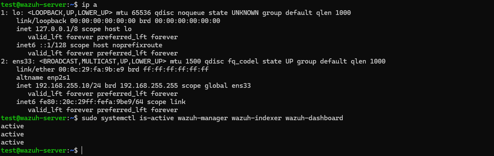

**Linux endpoint.** Built a second Ubuntu VM (`192.168.255.20`, also static),
installed the Wazuh agent pointed at the manager, and confirmed it registered.
The agent ships the endpoint's logs to the manager over the fixed server port
1514; the endpoint's side of the connection uses an ephemeral high port the OS
picks per connection.

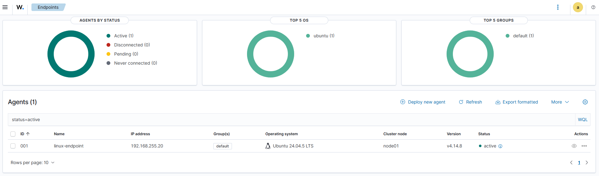

## Attack 1 — SSH brute force

**Method.** From Kali, confirmed SSH was reachable (`nc -zv 192.168.255.20 22`
→ open), then ran Hydra with a short wordlist of deliberately wrong passwords: hydra -l test -P wrongpasses.txt ssh://192.168.255.20

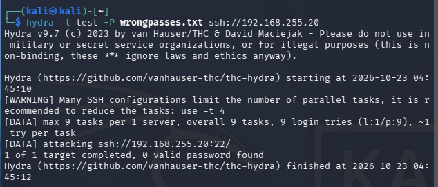

**Detection.** A single failed login matches built-in rule **5760** (level 5,
"sshd: authentication failed"). When failures pile up, Wazuh's correlation rule
**5763** (level 10) fires. Hydra's burst tripped it immediately: the alert
carried `"frequency":8` and a `previous_output` field holding the grouped
failures, each from a different ephemeral source port on `192.168.255.30`.

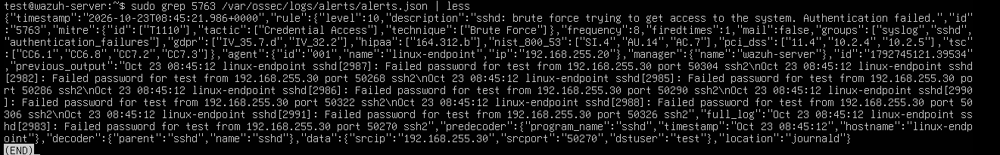

The jump from level 5 (routine noise) to level 10 (correlated attack) is the
point: a SOC filters on severity, so the correlation is what surfaces the
attack above the background of individual failures.

**Reading the real rule.** I found 5763 in the shipped ruleset
(`0095-sshd_rules.xml`): `frequency="8" timeframe="120" ignore="60"` — eight
failures within 120 seconds, then stay quiet for 60 so one attack can't spam
thousands of identical alerts.

## Attack 2 — Custom rule: successful root login

**Goal.** Extend Wazuh beyond its built-in ruleset. A successful SSH login as
`root` should never happen on a well-run host, but the built-in success rule
(5715) is low severity by design. I wrote a rule to flag it loudly.

**1. Found the base rule and field names with `wazuh-logtest`.**
Before writing anything, I used `sudo /var/ossec/bin/wazuh-logtest` to see how
Wazuh decodes real sshd lines. A failed login matched rule 5760 (level 5). A
successful login matched rule **5715** (level 3, "authentication success"), and
the decoder put the username in a field called `dstuser`. So my rule needed to
chain onto 5715 and add a condition on the username.

**2. Wrote the custom rule in `local_rules.xml`.**
Custom rules go in `/var/ossec/etc/rules/local_rules.xml`, which survives
upgrades, unlike the built-in ruleset under `/var/ossec/ruleset/`. I gave the
rule id `100002` (the 100000+ range is reserved for custom rules; I bumped it
from 100001 to avoid colliding with the shipped example) and level 12, higher
than the brute force rule's 10. It uses `<if_sid>5715</if_sid>` to fire only
after a successful login, a condition on the user `root`, and `$(srcip)` in the
description to name the source IP.

**3. Hit a "field is static" error and fixed it.**
My first version matched the username with `<field name="dstuser">^root$</field>`.
On restart, logtest rejected it: `Field 'dstuser' is static`. The
`<field name=...>` syntax is for dynamic fields only; `dstuser` is a static
field with its own dedicated `<user>` tag. Switching to `<user>^root$</user>`
loaded cleanly.

First version (rejected — `dstuser` matched with `<field>`):

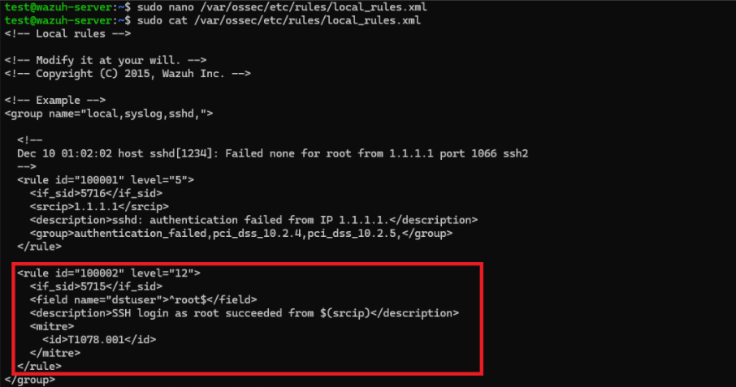

Corrected version (`<user>` tag):

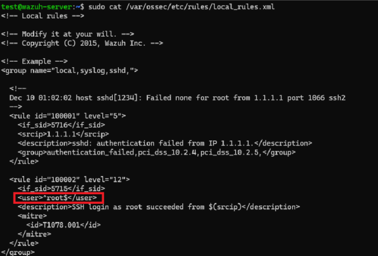

**4. Tested both ways with `wazuh-logtest`.**

Positive — a synthetic root login fires my rule (id 100002, level 12, source IP
resolved into the description):

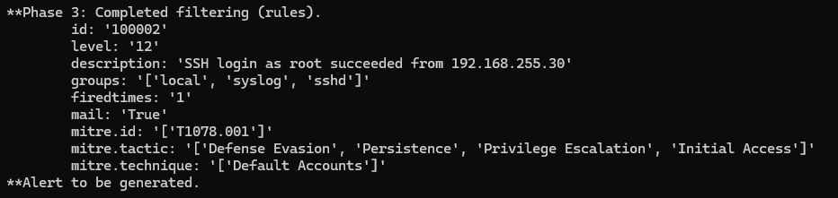

Negative — the same line for user `test` stays at plain 5715, level 3, and
100002 does not fire. The verbose trace shows Wazuh trying 100002 as a child of
5715 and rejecting it because the user isn't root — proof the condition
actually discriminates:

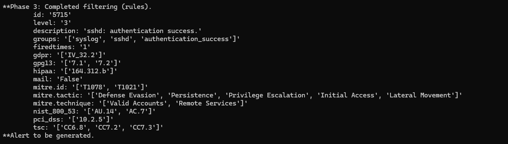

> Scope note: this is logtest-verified, not live-fired. Confirming it against a
> real login would mean enabling root SSH on the endpoint, which I deliberately
> avoided.

## Attack 3 — Port scan, and closing a blind spot

This is the core of the project: finding what the SIEM *couldn't* see, and
fixing it.

**The blind spot.** I scanned the endpoint from Kali
(`nmap` and `nmap -sV`). Both worked — `22/tcp open ssh`, and `-sV`
fingerprinted OpenSSH 9.6p1 — and the `999 closed tcp ports (reset)` line is
the SYN→RST mechanism a scanner uses to tell closed ports from open ones. But
**Wazuh raised no alert.** That's expected and worth stating plainly: Wazuh is
log-based, and a quiet scan never makes a service write a log line, so there's
nothing to detect.

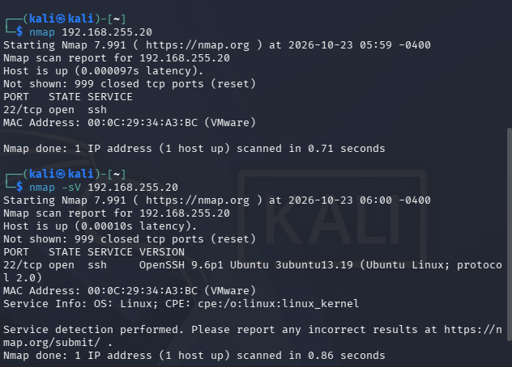

Both scans worked — `22/tcp open ssh`, and `-sV` fingerprinted OpenSSH 9.6p1 —
and the `999 closed tcp ports (reset)` line is the SYN→RST mechanism a scanner
uses to tell closed ports from open ones. But **Wazuh raised no alert.** That's
expected: Wazuh is log-based, and a quiet scan never makes a service write a log
line, so there's nothing to detect. This is the blind spot the rest of this
section closes.

**The fix: add a network IDS.** Suricata inspects packets, not logs, so it sees
what Wazuh can't. I installed it on the endpoint and pointed the Wazuh agent at
Suricata's `eve.json`, so network alerts flow into the same SIEM.

Two config fixes along the way (both in the problems table below): Suricata
defaulted to watching interface `eth0`, which doesn't exist on this VM (it's
`ens33`), and `HOME_NET` was set to `192.168.0.0/24`, which excludes my
`192.168.255.0/24` subnet — a subnet-mask detail that would have silently
broken detection.

**Re-scan, now detected.** With Suricata feeding Wazuh, an aggressive
`nmap -A -p-` lit up the SIEM with alerts tagged `src_ip 192.168.255.30`,
through the `linux-endpoint` agent — the same scan that was invisible before.

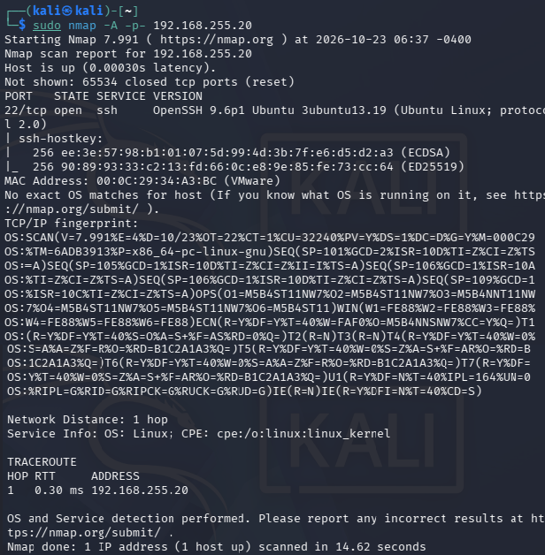

**Custom network rule.** The `-A` scan fired Suricata's generic
protocol-anomaly rules, not a dedicated scan signature. So I wrote my own
(`/var/lib/suricata/rules/local.rules`, SID in the user range 1000000+): alert tcp any any -> $HOME_NET any (msg:“LOCAL Nmap SYN scan detected”; flags:S; threshold: type threshold, track by_src, count 20, seconds 10; classtype:attempted-recon; sid:1000001; rev:1;)

A custom rule file does nothing until Suricata is told to load it, so I
registered `local.rules` under `rule-files` in `suricata.yaml`:

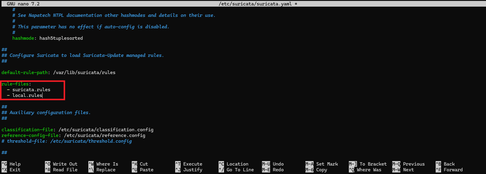

After re-scanning, Wazuh received alerts reading **"LOCAL Nmap SYN scan
detected"**, my own rule naming the attack.

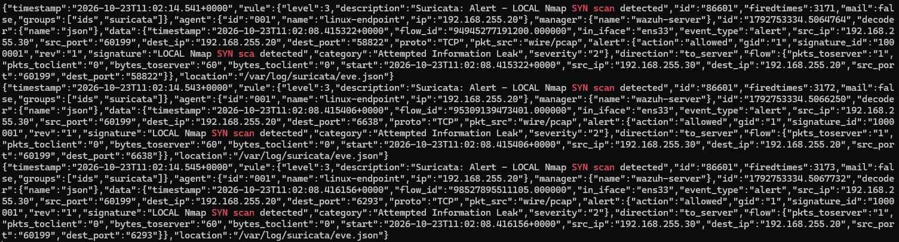

> Scope note: This rule is deliberately simple. It would also fire on
> legitimate high-volume connections, and a slow scan (`nmap -T1`) could stay
> under the threshold. A production rule would need tuning.

## Key Takeaways

- Built a working SIEM pipeline end to end: endpoint logs → agent → manager →
  alert, verified at each stage.
- Saw why correlation matters: a single failed login is noise (level 5); the
  same failures correlated become a level-10 brute force alert.
- Wrote and validated custom detection rules at both layers — a Wazuh rule
  (host) and a Suricata rule (network) — using the vendor-safe custom ID ranges.
- Found and closed a real detection gap: a log-based SIEM doesn't see network
  scans, and a network IDS is the right tool to cover it.

## Next Steps

- Add a Windows endpoint (Wazuh agent + Sysmon) to cover a mixed environment.
- Tune the custom scan rule against slow scans and legitimate high-volume traffic.
- Add Wazuh dashboards to visualize detections over time.

---

*Part of my cybersecurity portfolio — [profile →](PLACEHOLDER-your-profile-link)*
